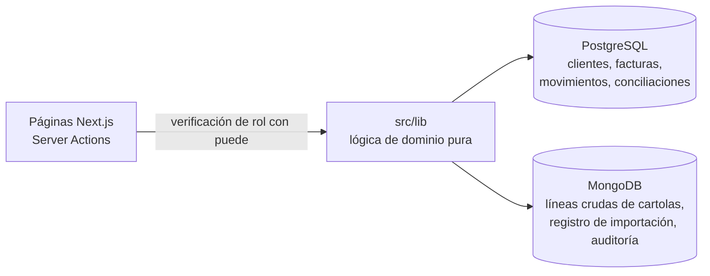

Read in English: [README.md](README.md)

# ConciliaPyme

Conciliación de cartolas bancarias y facturas para pymes chilenas. Un contador sube la cartola del banco
en CSV, la aplicación sugiere qué factura pendiente paga cada abono y una persona confirma la coincidencia.

Proyecto de portafolio: el foco está en la corrección con datos desordenados (importaciones idempotentes,
dos bases de datos sin una transacción compartida, confirmaciones concurrentes), la autorización en el
servidor y las pruebas.

## Live demo

**https://conciliapyme.vercel.app**

Acceso de demostración: `contador@demo.cl` / `Demo1234!` (datos ficticios; el entorno puede reiniciarse
en cualquier momento).

Corre en Vercel + Neon (PostgreSQL) + MongoDB Atlas, todos en planes gratuitos.

## Funcionalidades

- **Clientes y facturas**: CRUD con validación del RUT chileno (módulo 11) y montos enteros en CLP.
- **Importación de cartolas**: dos formatos CSV de banco (UTF-8 o Windows-1252), validación estricta,
  reimportaciones idempotentes y cartolas que se traslapan.
- **Sugerencias de coincidencia**: 100 = monto exacto + folio, 70 = monto exacto + vencimiento a 5 días
  o menos, 40 = diferencia pequeña (hasta max($1.000, 1 %)) + folio o fecha cercana.
- **Confirmación atómica**: el movimiento, la factura y el registro de conciliación cambian juntos, y de
  varias confirmaciones simultáneas solo una gana. Cada confirmación queda en un registro de auditoría de
  solo agregado.
- **Roles**: `CONTADOR` y `ADMIN` gestionan y confirman, `DUENO` consulta. Se verifica en el servidor en
  cada página y acción.

## Stack

Next.js 16 (App Router, Server Actions) · TypeScript · Tailwind CSS 4 · Auth.js v5 (credenciales, JWT,
bcrypt) · Prisma 6 + PostgreSQL 16 · Mongoose + MongoDB 7 · Zod · Vitest · Playwright · GitHub Actions ·
SonarCloud.



## Ejecutar en local

Requisitos: Node 22 (`.nvmrc`), Docker.

```bash
cp .env.example .env          # luego define AUTH_SECRET con un texto aleatorio
docker compose up -d          # PostgreSQL en 5433, MongoDB en 27017
npm ci
npx prisma migrate deploy
npx prisma db seed            # usuarios, clientes y facturas de demostración (se niega a correr en producción)
npm run dev                   # http://localhost:3000
```

O ejecuta la imagen de producción contra las bases de compose: `docker compose --profile app up --build`.

Usuarios de demostración (contraseña `Demo1234!`): `contador@demo.cl`, `dueno@demo.cl`, `admin@demo.cl`.
Cartolas de ejemplo: `tests/fixtures/banco-a.csv` y `tests/fixtures/banco-b.csv`.

## Pruebas

```bash
npm run lint
npm run typecheck
npm run test:cov    # unitarias + integración (requiere Docker en marcha); cobertura medida en src/lib
npm run test:e2e    # Playwright: inicio de sesión, importar una cartola, confirmar una coincidencia
```

Las pruebas de integración corren contra PostgreSQL y MongoDB reales y limpian solo lo que crean. El CI
ejecuta todo lo anterior y luego el quality gate de SonarCloud.

## Decisiones de diseño

Registradas como ADR en [`docs/adr`](docs/adr):

- [0001](docs/adr/0001-accepted-audit-risk.md) Avisos de `npm audit` aceptados en la CLI de Prisma 6.
- [0002](docs/adr/0002-idempotent-statement-import.md) Importación idempotente: SHA-256 del archivo único
  en MongoDB, hash por línea único en PostgreSQL, compensación manual con PostgreSQL como punto de
  confirmación.
- [0003](docs/adr/0003-atomic-confirmation-and-audit.md) Confirmación atómica con actualizaciones
  condicionales, auditoría escrita después del commit.

Otras decisiones: los montos son enteros en CLP; las fechas son medianoche UTC; una fila inválida rechaza
el archivo completo; los errores viajan como códigos en la URL, nunca como mensajes crudos; la
autorización nunca se hace en el middleware.

## Uso de IA

Construido con Claude Code. Un agente escribió el código, otros agentes lo revisaron (seguridad, UX/UI)
sin editarlo, y una persona decidió cada hallazgo. Los hallazgos y las decisiones están en
[`docs/ai-usage.md`](docs/ai-usage.md).

## Limitaciones conocidas

- **Límite de intentos de inicio de sesión en memoria.** Los intentos se cuentan en memoria por
  instancia serverless, así que en Vercel cada instancia lleva su propia cuenta y se reinicia en los
  arranques en frío; un almacén compartido como Redis es la mejora prevista.
- **Prisma está fijo en la versión 6.** Prisma 7 cambia la configuración, el generador y el seed, así que
  es una migración planificada por separado, no una actualización automática (Dependabot ignora las
  versiones mayores de Prisma).
- **Avisos de `npm audit` aceptados** ([ADR 0001](docs/adr/0001-accepted-audit-risk.md)):
  `deepmerge-ts` (GHSA-ggr8-5vv4-36mx) y `effect` (GHSA-7589-6fvf-x4pw), ambos de severidad alta, ambos
  dentro del cargador de configuración de la CLI de Prisma 6. Nunca procesan entradas de usuarios y solo
  se corrigen con Prisma 7.
- **La consistencia entre bases no es transaccional** ([ADR 0002](docs/adr/0002-idempotent-statement-import.md),
  [ADR 0003](docs/adr/0003-atomic-confirmation-and-audit.md)): las importaciones compensan a mano con
  PostgreSQL como punto de confirmación, y el evento de auditoría se escribe después del commit, así que
  una falla de MongoDB en ese momento pierde el evento (una tabla outbox lo haría durable).
- **Las cartolas no traen columna de cuenta**: el mismo movimiento en dos cuentas del mismo banco se
  guarda una sola vez.
- **Las sugerencias pueden equivocarse**: un folio que aparece como otro número en la descripción puede
  coincidir por azar; por eso la aplicación solo sugiere y una persona confirma.

## Licencia

[MIT](LICENSE)
