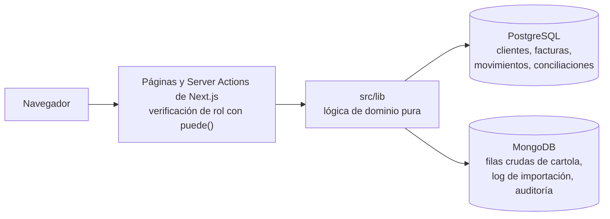

Read in English: [README.md](README.md)

# ConciliaPyme

[](https://github.com/JPozoAravena/conciliapyme/actions/workflows/ci.yml)
[](https://sonarcloud.io/summary/new_code?id=JPozoAravena_conciliapyme)
[](https://sonarcloud.io/summary/new_code?id=JPozoAravena_conciliapyme)
[](LICENSE)

Conciliación de cartolas bancarias con facturas para pymes chilenas. El contador sube la cartola CSV
del banco, la app sugiere qué factura pendiente paga cada abono y una persona confirma la coincidencia.

<p align="center">
  <!-- TODO: add docs/media/demo.gif -->
</p>

**[Demo en vivo](https://conciliapyme.vercel.app)** · Video (2 min) <!-- TODO: add video URL --> · [Arquitectura](#arquitectura) · [ADRs](docs/adr)

> Acceso de demo: `contador@demo.cl` / `Demo1234!`. Datos ficticios; el entorno se puede reiniciar en cualquier momento.
> Corre en Vercel + Neon (PostgreSQL) + MongoDB Atlas, todo en planes gratuitos.

## Puntos destacados

Proyecto de portafolio centrado en la corrección con datos desordenados, la autorización en el servidor
y las pruebas.

| Desafío | Cómo se resuelve |
| --- | --- |
| Reimportar la misma cartola o una que se superpone | Importación idempotente: SHA-256 del archivo único en MongoDB y hash por línea con contador de ocurrencias único en PostgreSQL. |
| Dos bases de datos sin transacción compartida | Compensación manual con PostgreSQL como punto de commit ([ADR 0002](docs/adr/0002-idempotent-statement-import.md)). |
| Dos personas confirmando la misma coincidencia a la vez | `prisma.$transaction` con actualizaciones condicionales: el movimiento, la factura y la conciliación cambian juntos, y gana una sola confirmación ([ADR 0003](docs/adr/0003-atomic-confirmation-and-audit.md)). |
| Acceso por rol | `CONTADOR` y `ADMIN` gestionan y confirman, `DUENO` consulta. Se verifica en el servidor en cada página y acción, nunca en el middleware. |
| Dinero y RUT | Montos enteros en CLP. RUT chileno validado con módulo 11. |
| Trazabilidad | Cada confirmación queda en un registro de auditoría append-only en MongoDB, escrito después del commit. |

## Capturas

<table>
  <tr>
    <td><!-- TODO: add docs/media/dashboard.png --><br/><sub>Panel principal</sub></td>
    <td><!-- TODO: add docs/media/import.png --><br/><sub>Importación de cartola</sub></td>
  </tr>
  <tr>
    <td><!-- TODO: add docs/media/reconciliation.png --><br/><sub>Sugerencias de conciliación</sub></td>
    <td><!-- TODO: add docs/media/invoices.png --><br/><sub>Facturas</sub></td>
  </tr>
  <tr>
    <td><!-- TODO: add docs/media/dark-mode.png --><br/><sub>Modo oscuro</sub></td>
    <td><!-- TODO: add docs/media/mobile.png --><br/><sub>Móvil</sub></td>
  </tr>
</table>

## Arquitectura



- **PostgreSQL** guarda el núcleo relacional (clientes, facturas, movimientos y conciliaciones), donde
  las restricciones y transacciones protegen el dinero y los cambios de estado.
- **MongoDB** guarda las filas crudas de la cartola, el log de importación y la auditoría: documentos
  append-only cuya forma sigue el archivo de cada banco.

<details>
<summary>Decisiones de diseño</summary>

Registradas como ADRs en [`docs/adr`](docs/adr):

- [0001](docs/adr/0001-accepted-audit-risk.md) Avisos de `npm audit` aceptados en el CLI de Prisma 6.
- [0002](docs/adr/0002-idempotent-statement-import.md) Importación idempotente: SHA-256 del archivo
  único en MongoDB, hash por línea único en PostgreSQL y compensación manual con PostgreSQL como punto
  de commit.
- [0003](docs/adr/0003-atomic-confirmation-and-audit.md) Confirmación atómica con actualizaciones
  condicionales y auditoría escrita después del commit.

Otras decisiones:

- Los montos son enteros en CLP; las fechas, medianoche UTC.
- Dos formatos CSV de banco (UTF-8 o Windows-1252) con validación estricta: una fila inválida rechaza
  el archivo completo.
- Sugerencias de coincidencia: 100 = monto exacto + folio, 70 = monto exacto + vencimiento a 5 días
  o menos, 40 = diferencia pequeña (hasta máx($1.000, 1%)) + folio o fecha cercana.
- Los errores viajan como códigos en la URL, nunca como mensajes crudos.
- La autorización nunca se hace en el middleware.

</details>

## Stack tecnológico

| Capa | Herramientas |
| --- | --- |
| Frontend | Next.js 16 (App Router, Server Actions), TypeScript, Tailwind CSS 4 |
| Backend | Auth.js v5 (credenciales, JWT, bcrypt), Zod |
| Datos | Prisma 6 + PostgreSQL 16, Mongoose + MongoDB 7 |
| Pruebas | Vitest, Playwright |
| CI/CD y calidad | GitHub Actions, quality gate de SonarCloud, Dependabot |
| Infraestructura | Docker (bases locales e imagen de producción), Vercel, Neon, MongoDB Atlas, Node 22 |

## Prácticas de ingeniería

- **Pruebas:** unitarias para la lógica de dominio, de integración contra PostgreSQL y MongoDB reales
  que limpian solo lo que crean, y E2E con Playwright para el login, la importación y la confirmación.
- **CI:** lint, typecheck, pruebas con cobertura y E2E en cada push, y luego el quality gate de
  SonarCloud.
- **Dependencias:** Dependabot, ignorando a propósito las versiones mayores de Prisma.
- **Flujo de trabajo:** `main` protegida, una rama y un PR por issue, squash merge y Conventional
  Commits validados con commitlint y husky.
- **Decisiones:** las decisiones de arquitectura quedan registradas como ADRs.

<details>
<summary>Ejecutar en local</summary>

Requisitos: Node 22 (`.nvmrc`) y Docker.

```bash
cp .env.example .env          # luego define AUTH_SECRET con un texto aleatorio
docker compose up -d          # PostgreSQL en 5433, MongoDB en 27017
npm ci
npx prisma migrate deploy
npx prisma db seed            # usuarios, clientes y facturas de demo (no corre en producción)
npm run dev                   # http://localhost:3000
```

O ejecuta la imagen de producción contra las bases del compose: `docker compose --profile app up --build`.

Usuarios de demo (contraseña `Demo1234!`): `contador@demo.cl`, `dueno@demo.cl`, `admin@demo.cl`.
Cartolas de ejemplo: `tests/fixtures/banco-a.csv` y `tests/fixtures/banco-b.csv`.

</details>

<details>
<summary>Pruebas</summary>

```bash
npm run lint
npm run typecheck
npm run test:cov    # unitarias + integración (requiere Docker); cobertura medida sobre src/lib
npm run test:e2e    # Playwright: login, importar una cartola y confirmar una coincidencia
```

La CI corre todo lo anterior y luego el quality gate de SonarCloud.

</details>

## Desarrollo asistido por IA

Hecho con Claude Code. Un agente escribió el código, otros agentes lo revisaron (seguridad, UX/UI) sin
editarlo y una persona decidió cada hallazgo. Los hallazgos y las decisiones están en
[`docs/ai-usage.md`](docs/ai-usage.md).

<details>
<summary>Limitaciones conocidas y hoja de ruta</summary>

- **Límite de intentos de login en memoria.** Los intentos se cuentan en memoria por instancia
  serverless, así que en Vercel cada instancia lleva su propia cuenta y se reinicia en los arranques en
  frío.
- **Prisma está fijo en la versión 6.** Prisma 7 cambia la configuración, el generador y el seed, así que
  es una migración aparte, no una actualización automática (Dependabot ignora las versiones mayores de
  Prisma).
- **Avisos de `npm audit` aceptados** ([ADR 0001](docs/adr/0001-accepted-audit-risk.md)):
  `deepmerge-ts` (GHSA-ggr8-5vv4-36mx) y `effect` (GHSA-7589-6fvf-x4pw), ambos altos y ambos dentro del
  cargador de configuración del CLI de Prisma 6. Nunca procesan datos del usuario y solo se corrigen con
  Prisma 7.
- **La consistencia entre bases no es transaccional** ([ADR 0002](docs/adr/0002-idempotent-statement-import.md),
  [ADR 0003](docs/adr/0003-atomic-confirmation-and-audit.md)): la importación compensa a mano con
  PostgreSQL como punto de commit, y el evento de auditoría se escribe después del commit, así que una
  falla de MongoDB en ese momento pierde el evento.
- **Las cartolas no traen columna de cuenta:** el mismo movimiento en dos cuentas del mismo banco se
  guarda una sola vez.
- **Las sugerencias pueden equivocarse:** un folio que aparece como otro número en la descripción puede
  coincidir por azar; por eso la app solo sugiere y una persona confirma.

Hoja de ruta:

- Un almacén compartido, como Redis, para el límite de intentos de login.
- Una tabla outbox para que los eventos de auditoría sean durables.
- Migración a Prisma 7.

</details>

## Autor

**Juan Pozo Aravena**, Software Engineer de Chile, disponible para trabajo remoto.
[LinkedIn](#) <!-- TODO: LinkedIn URL --> · [GitHub](https://github.com/JPozoAravena)

## Licencia

[MIT](LICENSE)
