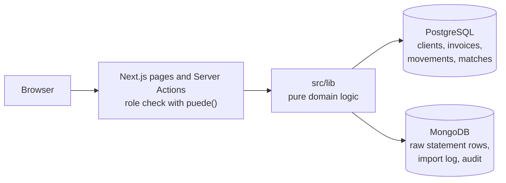

Leer en español: [README.es.md](README.es.md)

# ConciliaPyme

[](https://github.com/JPozoAravena/conciliapyme/actions/workflows/ci.yml)
[](https://sonarcloud.io/summary/new_code?id=JPozoAravena_conciliapyme)
[](https://sonarcloud.io/summary/new_code?id=JPozoAravena_conciliapyme)
[](LICENSE)

Bank statement and invoice reconciliation for Chilean SMEs. An accountant uploads the bank's CSV
statement, the app suggests which pending invoice each credit pays, and a person confirms the match.

<p align="center">
  <!-- TODO: add docs/media/demo.gif -->
</p>

**[Live demo](https://conciliapyme.vercel.app)** · Video (2 min) <!-- TODO: add video URL --> · [Architecture](#architecture) · [ADRs](docs/adr)

> Demo login: `contador@demo.cl` / `Demo1234!`. Fictitious data; the environment may be reset at any time.
> Runs on Vercel + Neon (PostgreSQL) + MongoDB Atlas, all on free plans.

## Highlights

Portfolio project focused on correctness with messy data, server-side authorization and tests.

| Challenge | How it's solved |
| --- | --- |
| Re-importing the same or an overlapping statement | Idempotent import: file SHA-256 unique in MongoDB, per-line hash with an occurrence counter unique in PostgreSQL. |
| Two databases without a shared transaction | Manual compensation with PostgreSQL as the commit point ([ADR 0002](docs/adr/0002-idempotent-statement-import.md)). |
| Two people confirming the same match at once | `prisma.$transaction` with conditional updates: movement, invoice and match change together, and only one confirmation wins ([ADR 0003](docs/adr/0003-atomic-confirmation-and-audit.md)). |
| Role-based access | `CONTADOR` and `ADMIN` manage and confirm, `DUENO` reads. Checked on the server in every page and action, never in middleware. |
| Money and tax IDs | Amounts are integer CLP. Chilean RUT validated with modulo 11. |
| Traceability | Every confirmation is written to an append-only audit log in MongoDB after the commit. |

## Screenshots

<table>
  <tr>
    <td><!-- TODO: add docs/media/dashboard.png --><br/><sub>Dashboard</sub></td>
    <td><!-- TODO: add docs/media/import.png --><br/><sub>Statement import</sub></td>
  </tr>
  <tr>
    <td><!-- TODO: add docs/media/reconciliation.png --><br/><sub>Reconciliation suggestions</sub></td>
    <td><!-- TODO: add docs/media/invoices.png --><br/><sub>Invoices</sub></td>
  </tr>
  <tr>
    <td><!-- TODO: add docs/media/dark-mode.png --><br/><sub>Dark mode</sub></td>
    <td><!-- TODO: add docs/media/mobile.png --><br/><sub>Mobile</sub></td>
  </tr>
</table>

## Architecture



- **PostgreSQL** holds the relational core (clients, invoices, movements, matches), where constraints
  and transactions protect money and state changes.
- **MongoDB** holds raw statement rows, the import log and the audit log: append-only documents
  whose shape follows each bank's file.

<details>
<summary>Design decisions</summary>

Recorded as ADRs in [`docs/adr`](docs/adr):

- [0001](docs/adr/0001-accepted-audit-risk.md) Accepted `npm audit` advisories in the Prisma 6 CLI.
- [0002](docs/adr/0002-idempotent-statement-import.md) Idempotent import: file SHA-256 unique in
  MongoDB, per-line hash unique in PostgreSQL, manual compensation with PostgreSQL as commit point.
- [0003](docs/adr/0003-atomic-confirmation-and-audit.md) Atomic confirmation with conditional updates,
  audit written after commit.

Other choices:

- Amounts are integer CLP; dates are UTC midnight.
- Two bank CSV formats (UTF-8 or Windows-1252) with strict validation: one invalid row rejects the
  whole file.
- Match suggestions: 100 = exact amount + folio, 70 = exact amount + due date within 5 days,
  40 = small difference (up to max($1,000, 1%)) + folio or close date.
- Errors travel as codes in the URL, never raw messages.
- Authorization is never done in middleware.

</details>

## Tech stack

| Layer | Tools |
| --- | --- |
| Frontend | Next.js 16 (App Router, Server Actions), TypeScript, Tailwind CSS 4 |
| Backend | Auth.js v5 (credentials, JWT, bcrypt), Zod |
| Data | Prisma 6 + PostgreSQL 16, Mongoose + MongoDB 7 |
| Testing | Vitest, Playwright |
| CI/CD & Quality | GitHub Actions, SonarCloud quality gate, Dependabot |
| Infra | Docker (local databases and production image), Vercel, Neon, MongoDB Atlas, Node 22 |

## Engineering practices

- **Tests:** unit tests for domain logic, integration tests against real PostgreSQL and MongoDB that
  clean up only what they create, and Playwright E2E for login, import and confirmation.
- **CI:** lint, typecheck, tests with coverage and E2E on every push, then the SonarCloud quality gate.
- **Dependencies:** Dependabot, with Prisma majors ignored on purpose.
- **Workflow:** protected `main`, one branch and PR per issue, squash merge, Conventional Commits
  enforced by commitlint and husky.
- **Decisions:** architecture decisions recorded as ADRs.

<details>
<summary>Run locally</summary>

Requirements: Node 22 (`.nvmrc`), Docker.

```bash
cp .env.example .env          # then set AUTH_SECRET to a random string
docker compose up -d          # PostgreSQL on 5433, MongoDB on 27017
npm ci
npx prisma migrate deploy
npx prisma db seed            # demo users, clients and invoices (refuses to run in production)
npm run dev                   # http://localhost:3000
```

Or run the production image against the compose databases: `docker compose --profile app up --build`.

Demo users (password `Demo1234!`): `contador@demo.cl`, `dueno@demo.cl`, `admin@demo.cl`.
Sample statements: `tests/fixtures/banco-a.csv` and `tests/fixtures/banco-b.csv`.

</details>

<details>
<summary>Tests</summary>

```bash
npm run lint
npm run typecheck
npm run test:cov    # unit + integration (needs Docker running); coverage measured on src/lib
npm run test:e2e    # Playwright: login, import a statement, confirm a match
```

CI runs all of the above, then SonarCloud's quality gate.

</details>

## AI-assisted development

Built with Claude Code. One agent wrote the code, separate agents reviewed it (security, UX/UI)
without editing, and a human decided every finding. Findings and decisions are in
[`docs/ai-usage.md`](docs/ai-usage.md).

<details>
<summary>Known limitations and roadmap</summary>

- **In-memory login rate limit.** Attempts are counted in memory per serverless instance, so on
  Vercel each instance keeps its own count and it resets on cold starts.
- **Prisma is pinned to 6.** Prisma 7 changes configuration, generator and seeding, so it is a
  migration of its own, not an automatic upgrade (Dependabot ignores Prisma majors).
- **Accepted `npm audit` advisories** ([ADR 0001](docs/adr/0001-accepted-audit-risk.md)):
  `deepmerge-ts` (GHSA-ggr8-5vv4-36mx) and `effect` (GHSA-7589-6fvf-x4pw), both high, both inside the
  Prisma 6 CLI config loader. They never process user input and are only fixed by Prisma 7.
- **Cross-database consistency is not transactional** ([ADR 0002](docs/adr/0002-idempotent-statement-import.md),
  [ADR 0003](docs/adr/0003-atomic-confirmation-and-audit.md)): imports compensate by hand with
  PostgreSQL as the commit point, and the audit event is written after the commit, so a MongoDB
  failure at that moment loses the event.
- **No account column in statements:** the same movement in two accounts of the same bank is stored
  once.
- **Suggestions can be wrong:** a folio that appears as another number in the description can match
  by chance, which is why the app only suggests and a person confirms.

Roadmap:

- Shared store such as Redis for the login rate limit.
- Outbox table to make audit events durable.
- Migration to Prisma 7.

</details>

## Author

**Juan Pozo Aravena**, Software Engineer from Chile, open to remote.
[LinkedIn](#) <!-- TODO: LinkedIn URL --> · [GitHub](https://github.com/JPozoAravena)

## License

[MIT](LICENSE)
