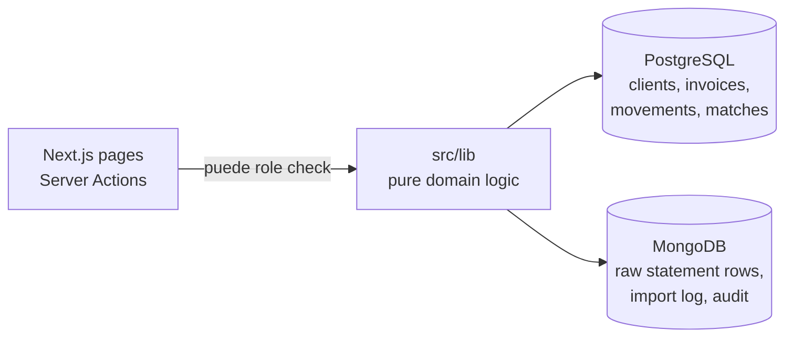

# ConciliaPyme

Bank statement and invoice reconciliation for Chilean SMEs. An accountant uploads the bank's CSV
statement, the app suggests which pending invoice each credit pays, and a person confirms the match.

Portfolio project: the focus is on correctness with messy data (idempotent imports, two databases
without a shared transaction, concurrent confirmations), server-side authorization and tests.

## Live demo

**https://conciliapyme.vercel.app**

Demo login: `contador@demo.cl` / `Demo1234!` (fictitious data; the environment may be reset at any time).

Runs on Vercel + Neon (PostgreSQL) + MongoDB Atlas, all on free plans.

## Features

- **Clients and invoices**: CRUD with Chilean RUT validation (modulo 11) and integer CLP amounts.
- **Statement import**: two bank CSV formats (UTF-8 or Windows-1252), strict validation, idempotent
  re-imports and overlapping statements.
- **Match suggestions**: 100 = exact amount + folio, 70 = exact amount + due date within 5 days,
  40 = small difference (up to max($1,000, 1%)) + folio or close date.
- **Atomic confirmation**: movement, invoice and reconciliation record change together, and only one
  of several simultaneous confirmations wins. Each confirmation is written to an append-only audit log.
- **Roles**: `CONTADOR` and `ADMIN` manage and confirm, `DUENO` reads. Checked on the server in every
  page and action.

## Stack

Next.js 16 (App Router, Server Actions) · TypeScript · Tailwind CSS 4 · Auth.js v5 (credentials, JWT,
bcrypt) · Prisma 6 + PostgreSQL 16 · Mongoose + MongoDB 7 · Zod · Vitest · Playwright · GitHub Actions ·
SonarCloud.



## Run locally

Requirements: Node 22 (`.nvmrc`), Docker.

```bash
cp .env.example .env          # then set AUTH_SECRET to a random string
docker compose up -d          # PostgreSQL on 5433, MongoDB on 27017
npm ci
npx prisma migrate deploy
npx prisma db seed            # demo users, clients and invoices (refuses to run in production)
npm run dev                   # http://localhost:3000
```

Or run the production image against the compose databases: `docker compose --profile app up --build`.

Demo users (password `Demo1234!`): `contador@demo.cl`, `dueno@demo.cl`, `admin@demo.cl`.
Sample statements: `tests/fixtures/banco-a.csv` and `tests/fixtures/banco-b.csv`.

## Tests

```bash
npm run lint
npm run typecheck
npm run test:cov    # unit + integration (needs Docker running); coverage measured on src/lib
npm run test:e2e    # Playwright: login, import a statement, confirm a match
```

Integration tests run against real PostgreSQL and MongoDB and clean up only what they create. CI runs
all of the above, then SonarCloud's quality gate.

## Design decisions

Recorded as ADRs in [`docs/adr`](docs/adr):

- [0001](docs/adr/0001-accepted-audit-risk.md) Accepted `npm audit` advisories in the Prisma 6 CLI.
- [0002](docs/adr/0002-idempotent-statement-import.md) Idempotent import: file SHA-256 unique in
  MongoDB, per-line hash unique in PostgreSQL, manual compensation with PostgreSQL as commit point.
- [0003](docs/adr/0003-atomic-confirmation-and-audit.md) Atomic confirmation with conditional updates,
  audit written after commit.

Other choices: amounts are integer CLP; dates are UTC midnight; one invalid row rejects the whole
file; errors travel as codes in the URL, never raw messages; authorization is never done in middleware.

## AI usage

Built with Claude Code. One agent wrote the code, separate agents reviewed it (security, UX/UI) without
editing, and a human decided every finding. Findings and decisions are in
[`docs/ai-usage.md`](docs/ai-usage.md).

## Known limitations

- **In-memory login rate limit.** Attempts are counted in memory per serverless instance, so on
  Vercel each instance keeps its own count and it resets on cold starts; a shared store such as
  Redis is the planned improvement.
- **Prisma is pinned to 6.** Prisma 7 changes configuration, generator and seeding, so it is a planned
  migration of its own, not an automatic upgrade (Dependabot ignores Prisma majors).
- **Accepted `npm audit` advisories** ([ADR 0001](docs/adr/0001-accepted-audit-risk.md)):
  `deepmerge-ts` (GHSA-ggr8-5vv4-36mx) and `effect` (GHSA-7589-6fvf-x4pw), both high, both inside the
  Prisma 6 CLI config loader. They never process user input and are only fixed by Prisma 7.
- **Cross-database consistency is not transactional** ([ADR 0002](docs/adr/0002-idempotent-statement-import.md),
  [ADR 0003](docs/adr/0003-atomic-confirmation-and-audit.md)): imports compensate by hand with
  PostgreSQL as the commit point, and the audit event is written after the commit, so a MongoDB
  failure at that moment loses the event (an outbox table would make it durable).
- **No account column in statements**: the same movement in two accounts of the same bank is stored
  once.
- **Suggestions can be wrong**: a folio that appears as another number in the description can match
  by chance, which is why the app only suggests and a person confirms.

## License

[MIT](LICENSE)
